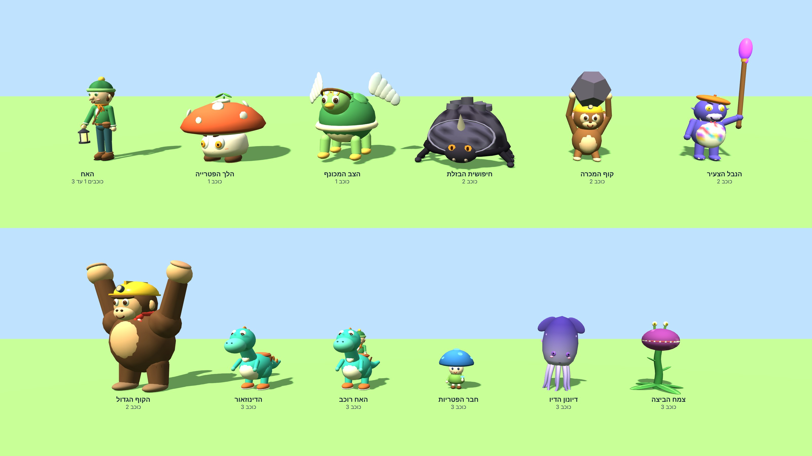

# Characters built in code

Moshe's decision (21.11.2026): the characters are improved with what the game already has, without a GLB model for each one. They don't have to look exactly like the characters that inspired the story. Every character in `js/characters.js` is an **original design** for this game in the role the story needs, and none copies an existing character.

`node tools/lineup.js` draws this picture (`tools/lineup.html`, the characters on their own, no level). `node tools/lineup.js <name> [side|back]` draws one character up close into `tools/out`.

## Who is who

| Character | Builder | Where | Look | Parts the level moves |
|---|---|---|---|---|
| The brother | `brother({ height, lantern, lit, sit })` | stars 1 to 3 (on star 3 he is the player) | tall and lanky, knitted green beanie with a pompom, green jacket over a cream shirt, orange scarf, satchel, teal trousers, laced boots, a lantern in his left hand | `g`, `armR` / `armL` (shoulder: waving, the lever), `lantern`, `bulb`, `glass` |
| Mushroom walker | `mushroomWalker()` | star 1 | rust cap shading darker toward the rim, cream spots, a leaf sprout, amber eyes, grumpy brows, waddling feet | `g`, `body`, `bang` |
| Winged turtle | `wingedTurtle()` | star 1 | glossy shell with raised plates and a cream rim, aviator goggles, two-part beak, wings that fan out to the side; stars over its head while dazed | `g`, `body`, `wings[].w`, `shadow`, `ring`, `dazed` |
| Basalt beetle | `basaltBeetle({ crackMat })` | star 2 | a dome of basalt columns (hexagon pattern), a front shield with a horn, glowing eyes, six legs in two tripods; stars while it is stuck | `g`, `body`, `back` (the glowing cracks), `dazed` |
| Mine monkey | `mineMonkey()` | star 2 | round and brown, pale face and belly, big ears, a miner's helmet with a lamp, a curled tail, a stone overhead | `g`, `body`, `stone` |
| Young villain | `youngVillain()` | star 2 and the flight to star 3 | a small blue-violet imp, orange beret, paint-splashed apron, little horns, a grin with one tooth, a tail dipped in paint | `g`, `brush`, `tip` |
| Big ape | `bigApe()` | star 2 (`?models=code`) | dark fur, tan face and chest, yellow hard hat with a lamp, red neckerchief, huge hands | `g`, `arms[]` (pointing up, holding the beam) |
| Dinosaur | `dinosaur()` | star 3 (`?models=code`) | teal with a cream belly, orange plates along the neck and tail, freckled snout, a leather saddle | the rider group, the tongue is the level's |
| Mushroom friend | `mushroomFriend()` | star 3 (`?models=code`) | small, under a deep-blue cap with glowing cyan spots, moss-green poncho, a glowing mushroom in his hand | `g` |
| Ink squid | `inkSquid()` | star 3 | indigo mantle fading to lavender, fins, glowing lilac spots, sleepy purple eyes, eight tentacles that pulse | `g` (the level scales it before it spits) |
| Swamp snapper | `swampSnapper()` | star 3 (`?models=code`) | a flytrap: two jaws with cream teeth, plum outside, pink inside, eyes on stalks, broad leaves; the jaws open wide when the level bends the stem back | `g`, `stem`, `dazed` |

The hero and Bowser keep their models. The big ape, the dinosaur, the mushroom friend and the swamp plant show the models already installed by default; `index.html?models=code` shows the code versions of all of them (the hero keeps his model).

## How a character is built

- **Parts.** A character is a few rigid parts: body, head, each arm, each leg. A `Part` collects spheres, domes, limbs (a rounded tube between two points), tubes along a curve (tails, tentacles, stems), cones, tori and lathe shapes, and `build()` merges them into one mesh per material, with the colour in each vertex. A colour can be a function of the vertex position, which draws stripes (the beanie), spots (the freckles), gradients (the squid, the cap) and patterns (the basalt hexagons, the paint splashes) without a texture.
- **Materials.** Three materials are shared by every character: `matte`, `gloss` and `lit` (unlit, for lamps, glowing spots and the dazed stars). Parts the level changes at run time keep their own material: the lantern glass, the brush tip, the beetle's cracks.
- **Fewer triangles for small shapes.** The number of segments follows the size of each shape (a nose gets 6, a body 18). Faces get a few more.
- **Size.** `fit()` scales the body to the height asked for and stands it on y = 0. The levels keep the sizes they had.
- **Eyes** are their own part, placed on the line through both eye centres, so a blink squashes them flat for 0.14 s every 2 to 5 seconds (now and then twice).
- **Animation** (`Characters.update(dt)`, once per frame in `index.html`): breathing, blinking, and a walk cycle driven by how fast the character really moves in the world, so the level code did not change. Extras per character: the walker's feet and sprout, the turtle's nodding head, the beetle's tripod legs, the monkey's and the villain's tails, the squid's tentacles, the snapper's jaws. On star 3 `index.html` tells the brother when the hero jumps and punches (`Characters.drive`).
- **Inner pivots.** The level turns the outer pivot (a shoulder), the walk cycle turns an inner one (the swing), so they never fight.

## Cost

Measured with `node tools/char-frames.js` (headless, software rendering; the numbers count draw calls and triangles, not speed). "Own" is the character alone; "frame" is the whole frame from the follow camera a few units away.

| Character | Own draw calls, before → after | Own triangles, before → after | Frame triangles, before → after |
|---|---|---|---|
| Brother, star 1 (balcony) | 16 → 13 | 1,000 → 6,176 | 338k → 343k |
| Brother, star 2 | 8 → 12 | 380 → 5,924 | 188k → 188k |
| Brother, star 3 (the player) | 5 → 9 | 276 → 5,480 | 293k → 298k |
| Mushroom walker | 22 → 5 | 2,760 → 3,594 | 309k → 317k |
| Winged turtle | 29 → 9 | 3,586 → 5,516 | 306k → 313k |
| Basalt beetle | 16 → 7 | 1,104 → 3,200 | 206k → 206k |
| Mine monkey | 9 → 7 | 1,116 → 3,944 | 185k → 190k |
| Young villain | 11 → 8 | 1,216 → 4,758 | 186k → 189k |
| Ink squid | 11 → 4 | 752 → 4,712 | 302k → 310k |

With `?models=code` (installed model → code version): big ape 1 → 7 draw calls and 704 → 8,700 triangles, dinosaur 2 → 7 and 687 → 6,574, mushroom friend 1 → 3 and 14,458 → 3,654, swamp plant 15 → 5 and 794 → 4,378.

The busiest frame is still the balcony on star 1 at 343 thousand triangles and 170 draw calls. Draw calls went down for most characters; triangles went up by 2 to 5 thousand per character, which buys the round shapes and the faces. Frame rate on a real phone has not been measured.

The frame budget is 350 draw calls and 350 thousand triangles (`docs/performance-rules.md`).
