# מריו גלקסי: איך נבנה שלב גני הרוח
# Mario Galaxy: How the Wind Gardens Level Was Built

תיעוד קצר של תהליך הבנייה, בצילומי מסך מהמשחק עצמו. כל התמונות צולמו בדפדפן headless עם רינדור תוכנה, ולכן הצבעים וקצב התמונות אינם מייצגים מכשיר אמיתי.

A short record of the build, told through screenshots of the game itself. All images were captured in a headless browser with software rendering, so colors and frame rate do not represent a real device.

**המטרה:** כוכב ראשון שחיק מתוך ארבעה, כ־20 דקות למשחק ראשון של ילד בגיל 7 עד 8. מריו נוחת לבד, רואה את הפנס של לואיג׳י, לומד אגרוף וקפיצה כפולה, חוצה גשר שבור ועוצר טחנת רוח כדי לחלץ את אחיו.

**Goal:** a playable first star out of four, about 20 minutes for a first run by a 7 to 8 year old. Mario lands alone, spots Luigi's lantern, learns to punch and double jump, crosses a broken bridge, and stops a windmill to rescue his brother.

## 1. נקודת מוצא / Starting point

המשחק התחיל כמשחק קטן על כוכבים עגולים: כוכב ירוק, מריו, קפיצה אחת ואיסוף חמישה שברי כוכב.

The game began as a small platformer on round planets: one green planet, Mario, a single jump and five star shards to collect.

| | |
|---|---|
| 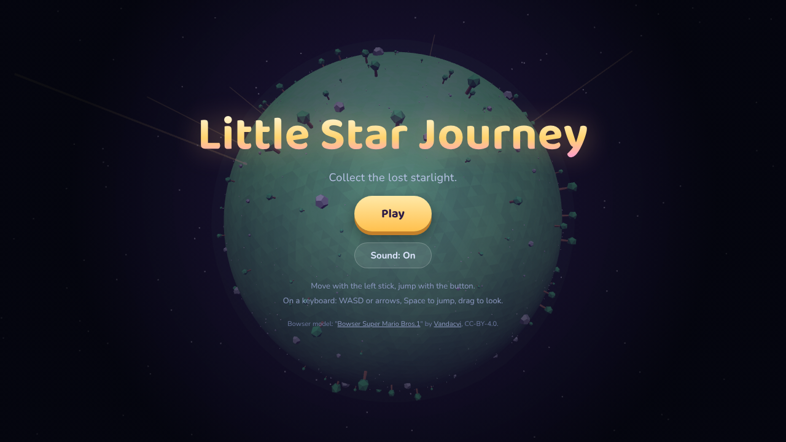 | 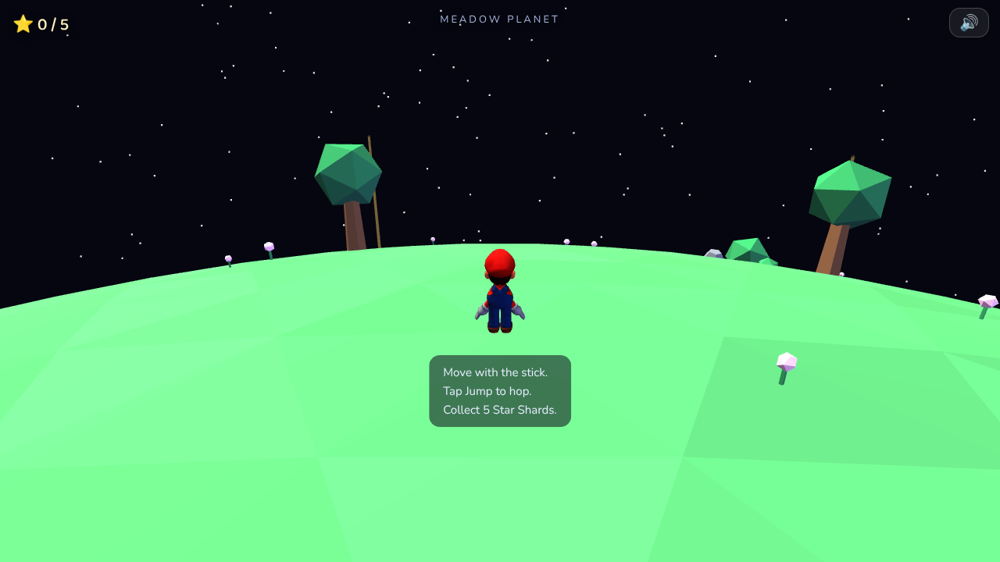 |
| התפריט המקורי / The original menu | הכוכב הראשון לפני השינוי: אין מסלול, אויבים או חידה / The first planet before the change: no route, enemies or puzzle |

## 2. נחיתה ומטרה ברורה / Landing with a clear goal

הילד צריך לדעת לאן ללכת בלי הסבר. מהנחיתה רואים את הטחנה ואת קרן האור של הפנס, שמהבהב בקצב קבוע: הבזק ארוך ושניים קצרים. שביל זהוב מוביל אליהן, ודגלי בד משני צדי הדרך.

The child should know where to go without instructions. From the landing spot you see the windmill and the lantern's beam, flashing a fixed pattern: one long flash, then two short. A golden path leads toward them, with cloth flags on both sides.

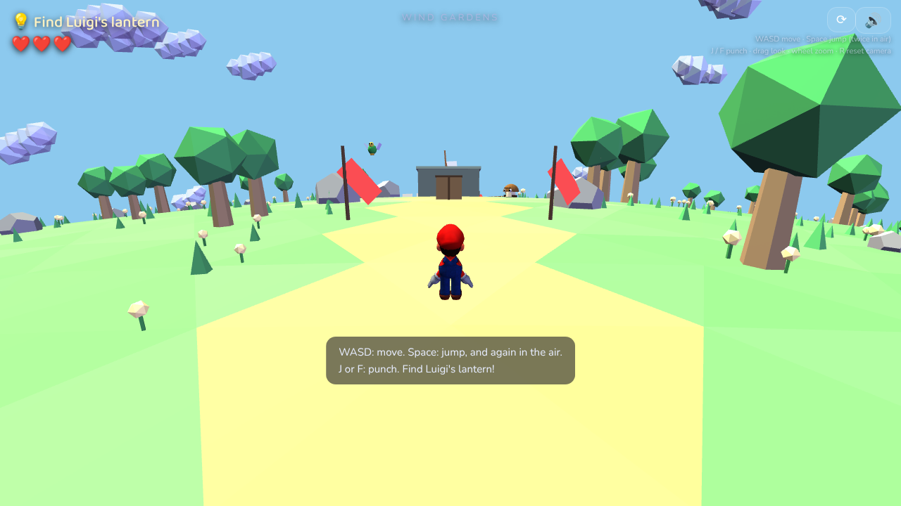

## 3. ללמוד כל יכולת במקום סלחני / Learning each skill somewhere forgiving

כל מיומנות נלמדת לבדה, לפני שמשלבים אותה עם סכנה.

Each skill is taught on its own, before it is combined with a hazard.

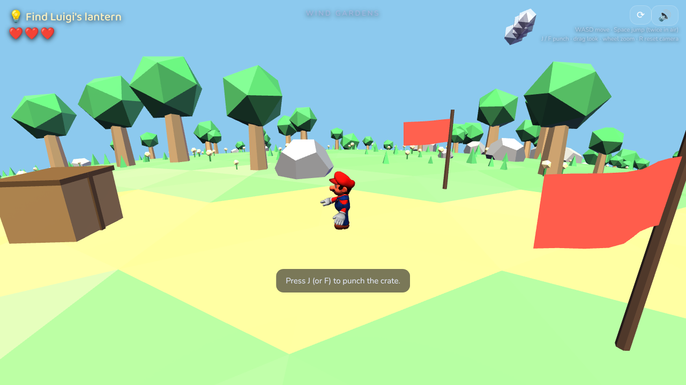

**אגרוף.** ארגז במרכז השביל מזמין לנסות. לאגרוף יש עזר כיוון: אם משהו קרוב מלפנים, מריו מסתובב אליו.
**Punch.** A crate in the middle of the path invites a try. The punch has aim assist: if something is close ahead, Mario turns toward it.

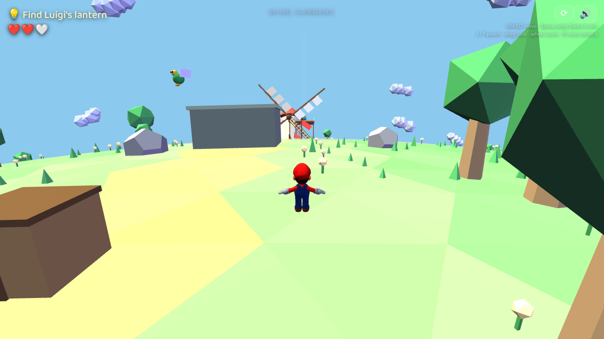

**גומבה.** היא מתריעה ב"!", קופצת, ואז מסתערת בקו ישר. צריך לזוז הצידה או להכות אותה לפני המגע.
**Goomba.** It warns with a "!", hops, then charges in a straight line. Sidestep it, or punch it before contact.

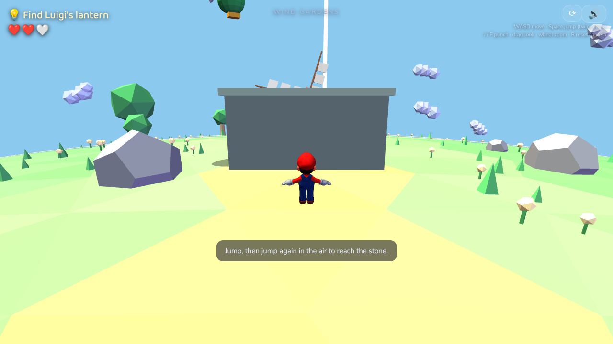

**קפיצה כפולה.** הבמה גבוהה מקפיצה אחת (3.4 מול 2.76), אז רק קפיצה שנייה באוויר מעלה אליה.
**Double jump.** The pedestal is taller than one jump (3.4 vs 2.76), so only a second jump in mid-air gets Mario up.

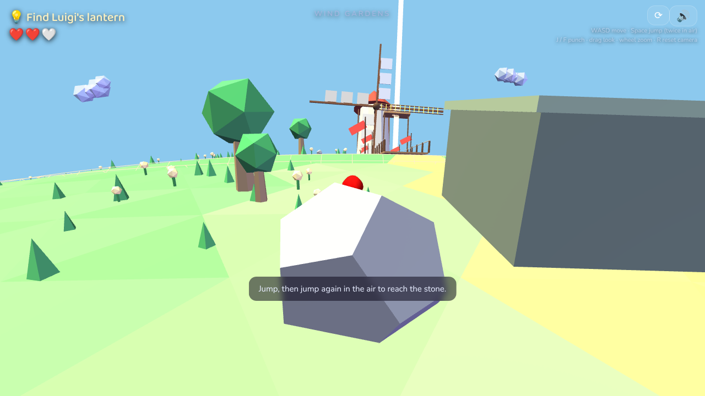

**קופה מכונפת.** צל כהה על הקרקע מראה איפה היא תצלול, ומהבהב רגע לפני כן.
**Winged koopa.** A dark shadow on the ground shows where it will dive, and flashes just before.

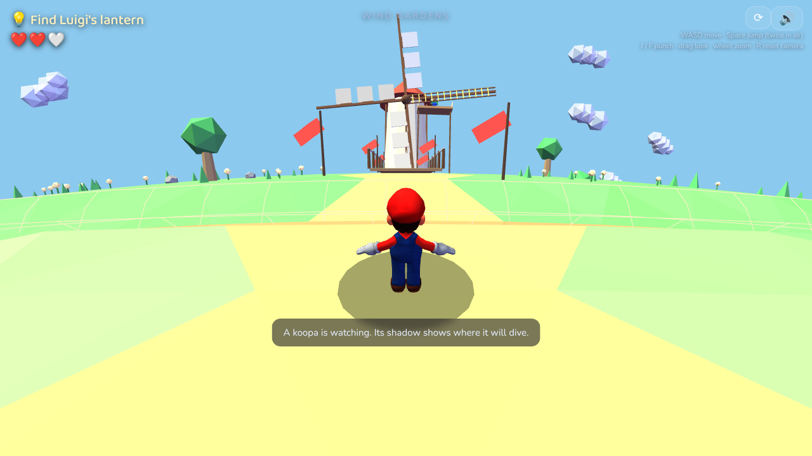
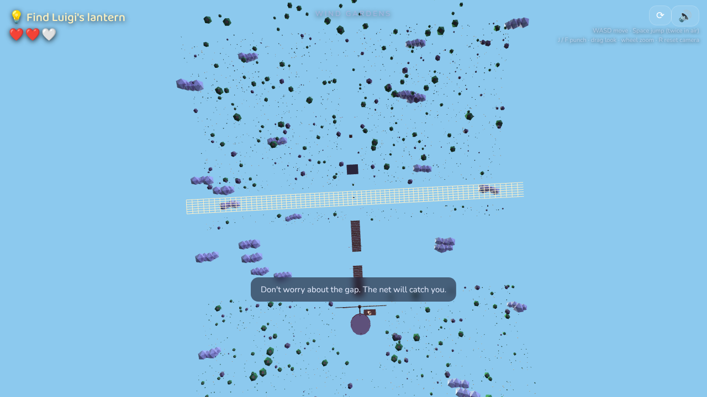

**תעלת אימון עם רשת.** אפשר לטעות כאן בלי עונש. הרשת עמוקה 3 יחידות ואפשר לצאת ממנה בהליכה או בקפיצה.
**Training trench with a net.** Mistakes cost nothing here. The net is 3 units down and Mario can climb out by walking or jumping.

## 4. הרוח / The wind

דגלי הבד הם הרוח עצמה. הכיוון והעוצמה מגיעים ממקור יחיד בקוד (`GameShared.wind`), ומשם גם הדגלים וגם הסחף של מריו. הרוח נוטה את הקפיצה הצידה, והילד קורא אותה מהדגלים.

The cloth flags are the wind itself. Direction and strength come from one source in code (`GameShared.wind`), which drives both the flags and Mario's drift. Wind bends a jump sideways, and the child reads it from the flags.

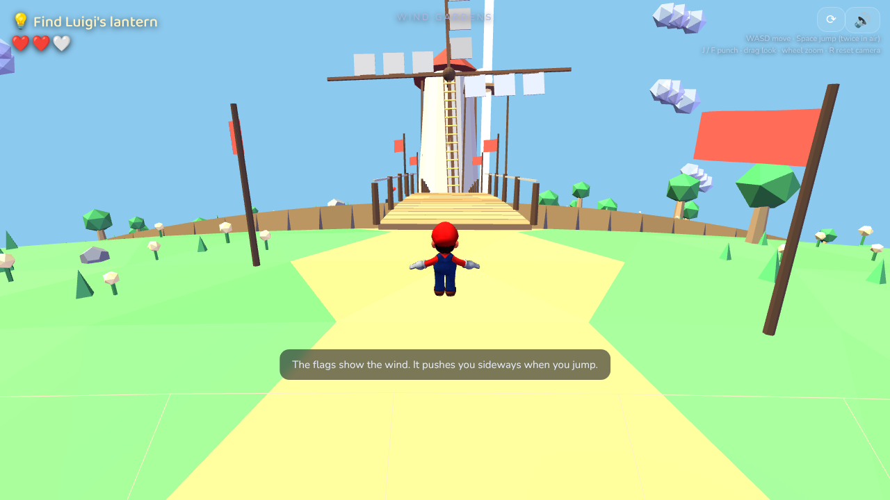

## 5. הגשר / The bridge

תעלה טבעתית מקיפה את הכוכב, כך שהגשר הוא הדרך היחידה לעבור. באמצעו רווח של 9 יחידות, ארוך מכל קפיצה בודדת. הבדיקה האוטומטית אישרה שקפיצה אחת נופלת וקפיצה כפולה נוחתת. נפילה מחזירה לנקודת ביקורת בלי לפגוע בלבבות.

A canyon ring circles the planet, so the bridge is the only way across. A 9 unit gap in the middle is longer than any single jump. The automated test confirmed that one jump falls and a double jump lands. A fall returns Mario to a checkpoint without costing hearts.

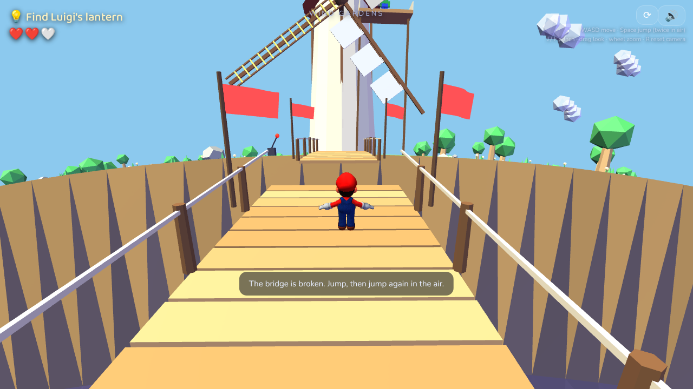
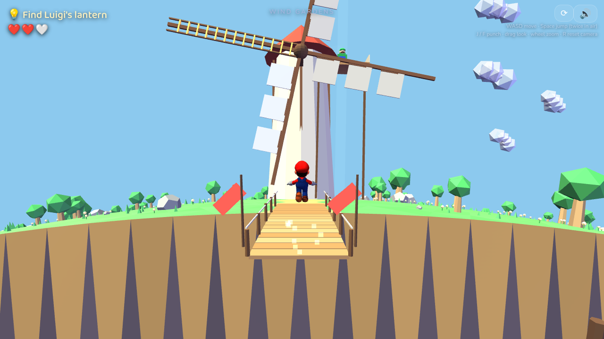

## 6. חידת הטחנה / The windmill puzzle

הכנפיים קצרות מכדי להגיע למרפסת. אגרוף בידית האדומה עוצר אותן, ורק לכנף אחת יש סולם. אם היא נעצרת בכיוון הלא נכון, הבלם מחליק וניתן לנסות שוב. אם היא נעצרת כלפי מטה, השחקן מטפס.

The blades are too short to reach the balcony. Punching the red lever stops them, and only one blade carries a ladder. If it stops the wrong way, the brake slips and Mario can try again. If it stops pointing down, the player climbs.

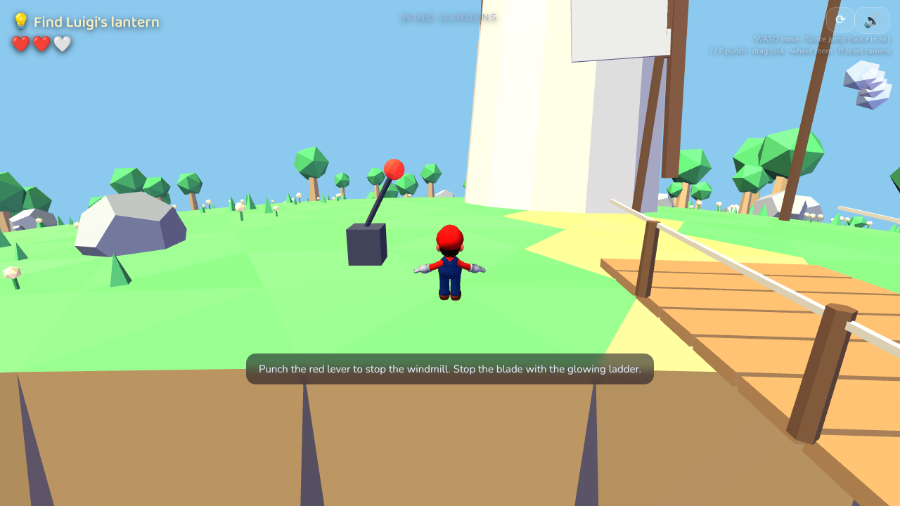
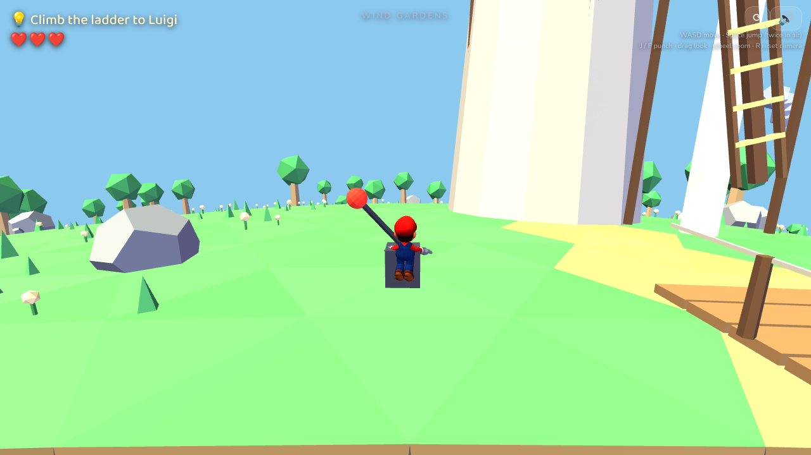
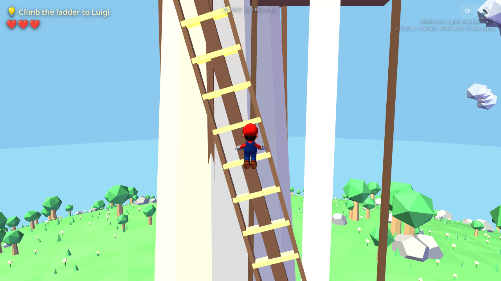

## 7. החילוץ / The rescue

הנחיתה במרפסת מפעילה את החילוץ פעם אחת: לואיג׳י מסתובב, מנופף ויורד אל קרונית שעליה האותיות DK, והשער לכוכב הבא נפתח.

Landing on the balcony triggers the rescue exactly once: Luigi turns, waves and hops down to a cart marked DK, and the gate to the next star opens.

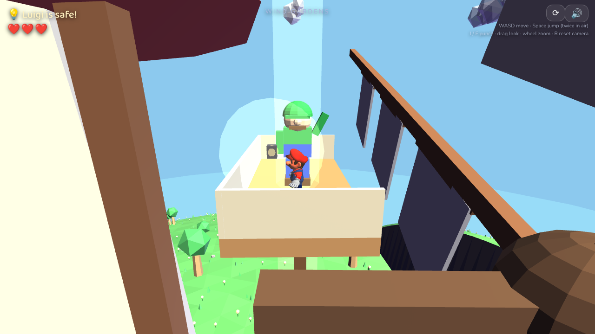
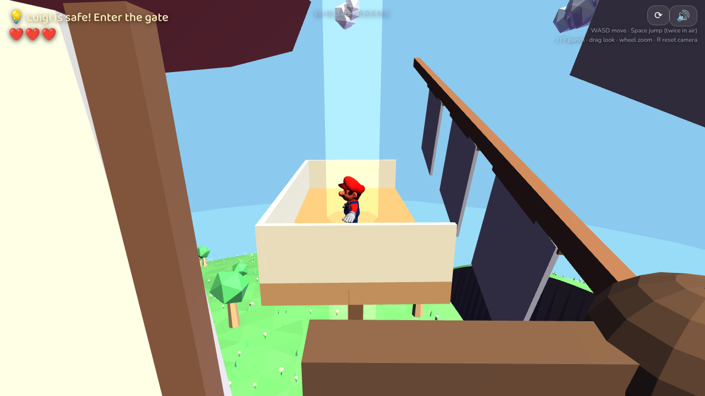

## מה היה חשוב בדרך / What mattered along the way

- **מקור אמת אחד.** רוח, בלם ושמות פעולות הקלט מוגדרים במקום אחד, כדי שכמה סוכנים יוכלו לעבוד במקביל בלי להתנגש.
  **One source of truth.** Wind, brake and input action names live in one place so several agents can work in parallel without collisions.
- **פיזיקה ותצוגה מאותה פונקציה.** התעלה והקניון משנים גם את הרשת הגרפית וגם את הקרקע לפי אותה נוסחה, כך שמה שרואים הוא מה שדורכים עליו.
  **Physics and visuals from one function.** The trench and canyon reshape both the mesh and the ground by the same formula, so what you see is what you stand on.
- **בדיקות דטרמיניסטיות.** סקריפט מקדם את הסימולציה בלי רינדור, ובודק קפיצות, חידה, אויבים ומעבר שלב.
  **Deterministic tests.** A script advances the simulation without rendering and checks jumps, the puzzle, enemies and the level transition.
- **מה עוד לא נעשה.** לא נבדק על מכשיר מגע אמיתי, לא נמדדו ביצועים ולא שיחק בו ילד. מודל לואיג׳י הוא עדיין מצולעים פשוטים והארט הסופי פתוח.
  **Not done yet.** Not tested on a real touch device, performance not measured, no child has played it. Luigi is still simple primitives and final art is open.

פרטים טכניים מלאים / Full technical details: [`../wind-gardens.md`](../wind-gardens.md)
