# מסע בין כוכבים: איך נבנה שלב גני הרוח
# Star Journey: How the Wind Gardens Level Was Built

תיעוד קצר של תהליך הבנייה, בצילומי מסך מהמשחק עצמו. כל התמונות צולמו בדפדפן headless עם רינדור תוכנה, ולכן הצבעים וקצב התמונות אינם מייצגים מכשיר אמיתי.

A short record of the build, told through screenshots of the game itself. All images were captured in a headless browser with software rendering, so colors and frame rate do not represent a real device.

**המטרה:** כוכב ראשון שחיק מתוך ארבעה, כ־20 דקות למשחק ראשון של ילד בגיל 7 עד 8. הגיבור נוחת לבד, רואה את הפנס של האח, לומד אגרוף וקפיצה כפולה, חוצה גשר שבור ועוצר טחנת רוח כדי לחלץ את אחיו.

**Goal:** a playable first star out of four, about 20 minutes for a first run by a 7 to 8 year old. the hero lands alone, spots the brother's lantern, learns to punch and double jump, crosses a broken bridge, and stops a windmill to rescue his brother.

## 1. נקודת מוצא / Starting point

המשחק התחיל כמשחק קטן על כוכבים עגולים: כוכב ירוק, הגיבור, קפיצה אחת ואיסוף חמישה שברי כוכב.

The game began as a small platformer on round planets: one green planet, the hero, a single jump and five star shards to collect.

| | |
|---|---|
| 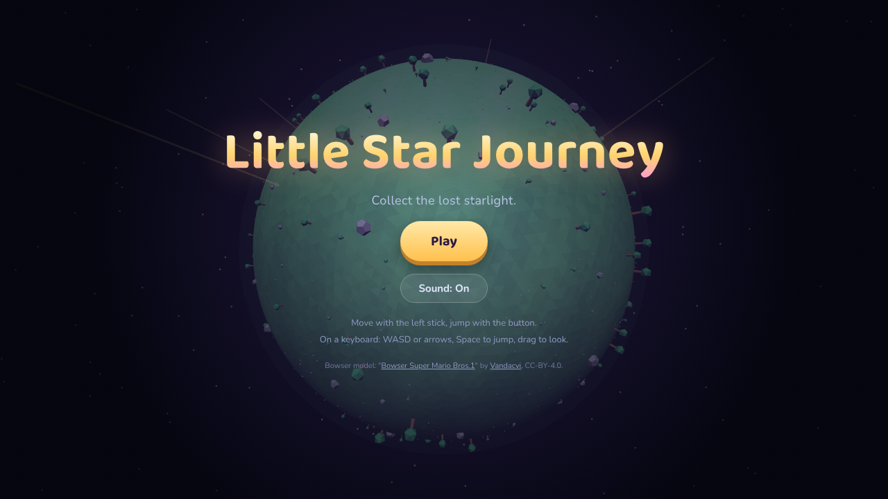 | 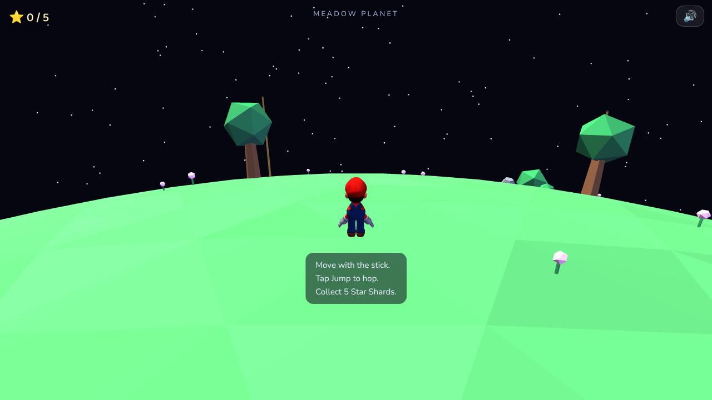 |
| התפריט המקורי / The original menu | הכוכב הראשון לפני השינוי: אין מסלול, אויבים או חידה / The first planet before the change: no route, enemies or puzzle |

## 2. נחיתה ומטרה ברורה / Landing with a clear goal

הילד צריך לדעת לאן ללכת בלי הסבר. מהנחיתה רואים את הטחנה ואת קרן האור של הפנס, שמהבהב בקצב קבוע: הבזק ארוך ושניים קצרים. שביל זהוב מוביל אליהן, ודגלי בד משני צדי הדרך.

The child should know where to go without instructions. From the landing spot you see the windmill and the lantern's beam, flashing a fixed pattern: one long flash, then two short. A golden path leads toward them, with cloth flags on both sides.

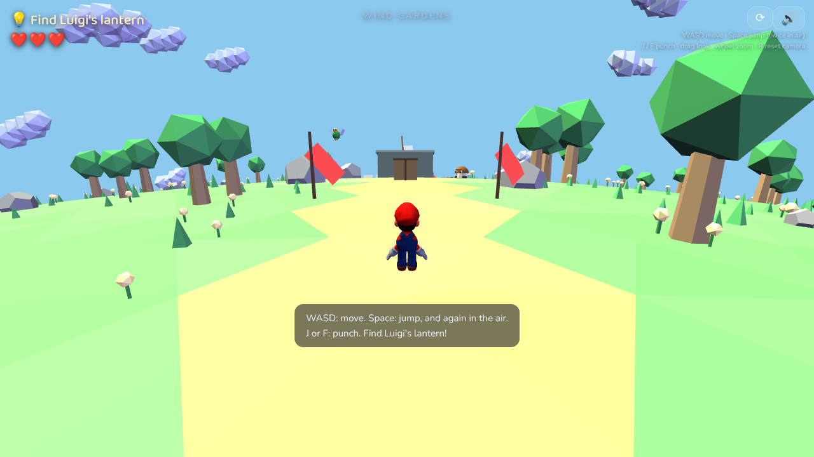

## 3. ללמוד כל יכולת במקום סלחני / Learning each skill somewhere forgiving

כל מיומנות נלמדת לבדה, לפני שמשלבים אותה עם סכנה.

Each skill is taught on its own, before it is combined with a hazard.

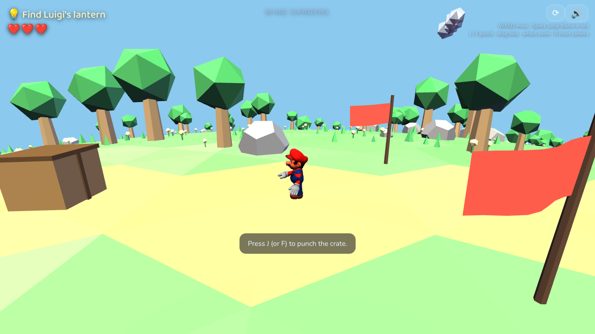

**אגרוף.** ארגז במרכז השביל מזמין לנסות. לאגרוף יש עזר כיוון: אם משהו קרוב מלפנים, הגיבור מסתובב אליו.
**Punch.** A crate in the middle of the path invites a try. The punch has aim assist: if something is close ahead, the hero turns toward it.

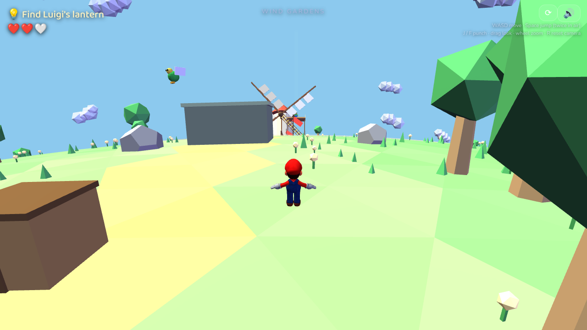

**יצור הפטרייה.** היא מתריעה ב"!", קופצת, ואז מסתערת בקו ישר. צריך לזוז הצידה או להכות אותה לפני המגע.
**Mushroom walker.** It warns with a "!", hops, then charges in a straight line. Sidestep it, or punch it before contact.

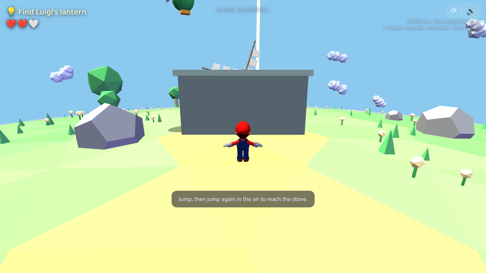

**קפיצה כפולה.** הבמה גבוהה מקפיצה אחת (3.4 מול 2.76), אז רק קפיצה שנייה באוויר מעלה אליה.
**Double jump.** The pedestal is taller than one jump (3.4 vs 2.76), so only a second jump in mid-air gets the hero up.

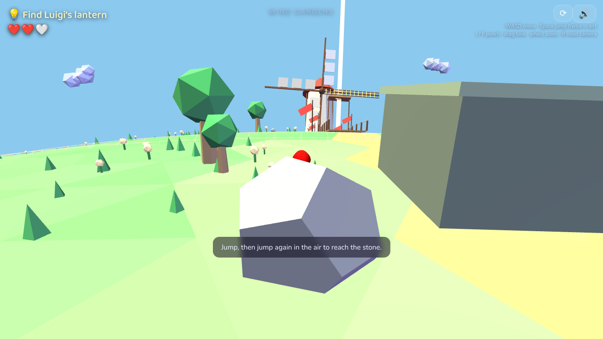

**הצב המכונף.** צל כהה על הקרקע מראה איפה היא תצלול, ומהבהב רגע לפני כן.
**Winged turtle.** A dark shadow on the ground shows where it will dive, and flashes just before.

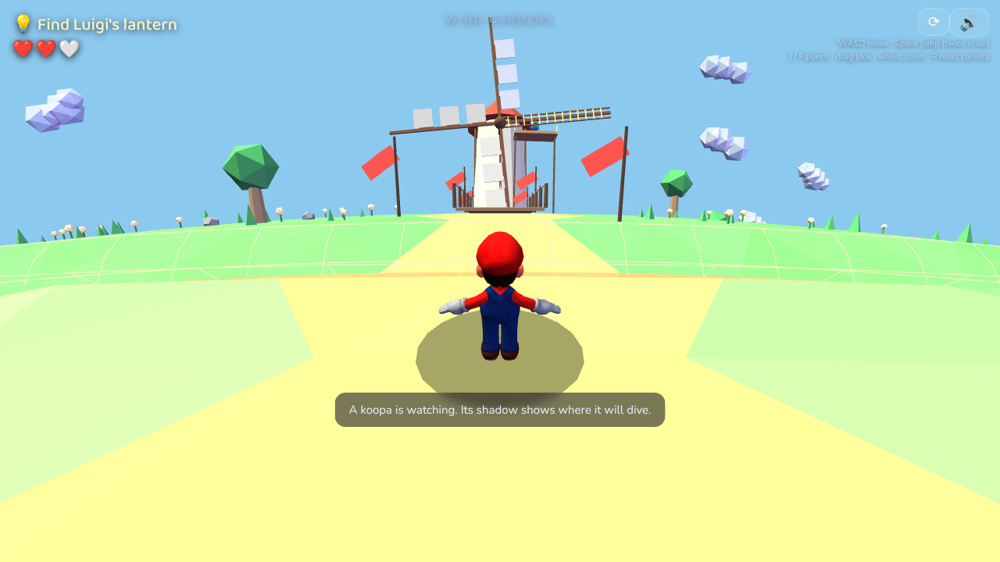
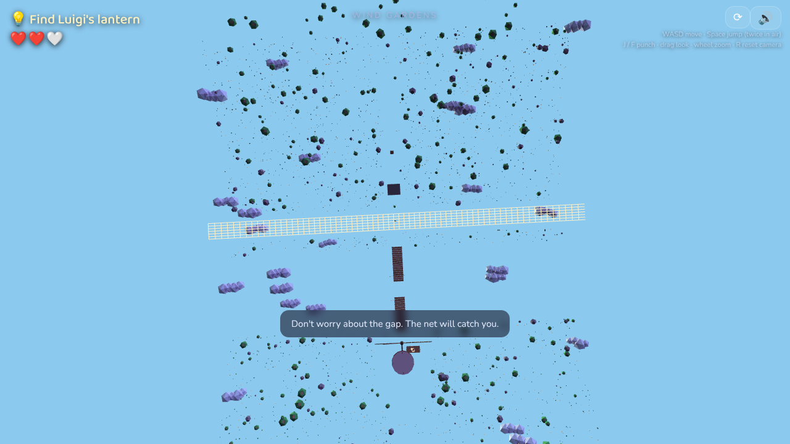

**תעלת אימון עם רשת.** אפשר לטעות כאן בלי עונש. הרשת עמוקה 3 יחידות ואפשר לצאת ממנה בהליכה או בקפיצה.
**Training trench with a net.** Mistakes cost nothing here. The net is 3 units down and the hero can climb out by walking or jumping.

## 4. הרוח / The wind

דגלי הבד הם הרוח עצמה. הכיוון והעוצמה מגיעים ממקור יחיד בקוד (`GameShared.wind`), ומשם גם הדגלים וגם הסחף של הגיבור. הרוח נוטה את הקפיצה הצידה, והילד קורא אותה מהדגלים.

The cloth flags are the wind itself. Direction and strength come from one source in code (`GameShared.wind`), which drives both the flags and the hero's drift. Wind bends a jump sideways, and the child reads it from the flags.

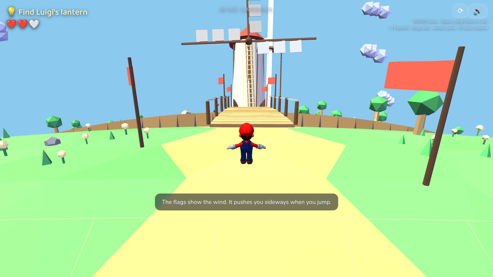

## 5. הגשר / The bridge

תעלה טבעתית מקיפה את הכוכב, כך שהגשר הוא הדרך היחידה לעבור. באמצעו רווח של 9 יחידות, ארוך מכל קפיצה בודדת. הבדיקה האוטומטית אישרה שקפיצה אחת נופלת וקפיצה כפולה נוחתת. נפילה מחזירה לנקודת ביקורת בלי לפגוע בלבבות.

A canyon ring circles the planet, so the bridge is the only way across. A 9 unit gap in the middle is longer than any single jump. The automated test confirmed that one jump falls and a double jump lands. A fall returns the hero to a checkpoint without costing hearts.

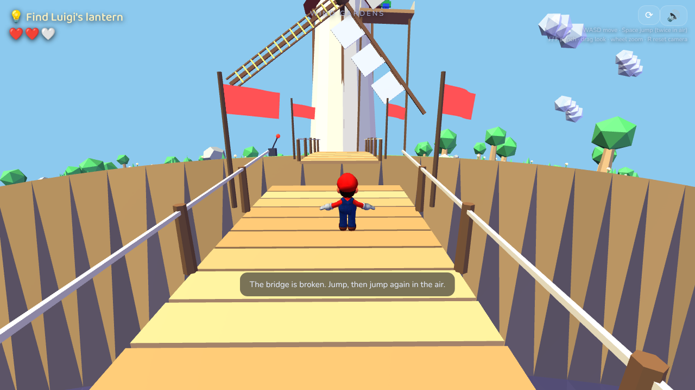
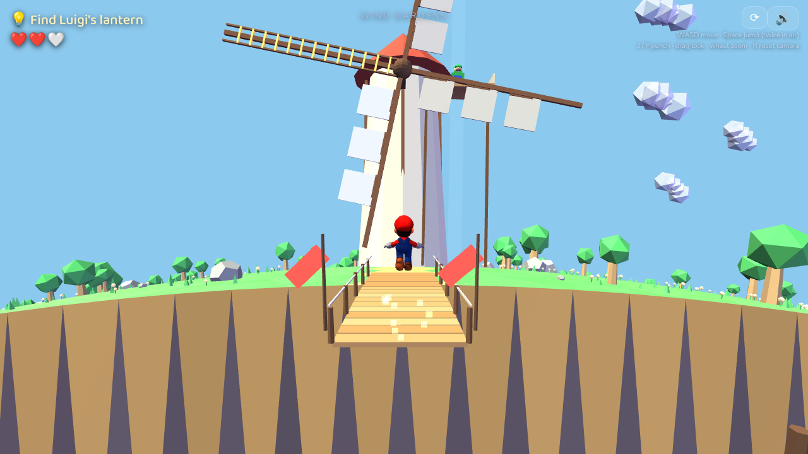

## 6. חידת הטחנה / The windmill puzzle

הכנפיים קצרות מכדי להגיע למרפסת. אגרוף בידית האדומה עוצר אותן, ורק לכנף אחת יש סולם. אם היא נעצרת בכיוון הלא נכון, הבלם מחליק וניתן לנסות שוב. אם היא נעצרת כלפי מטה, השחקן מטפס.

The blades are too short to reach the balcony. Punching the red lever stops them, and only one blade carries a ladder. If it stops the wrong way, the brake slips and the hero can try again. If it stops pointing down, the player climbs.

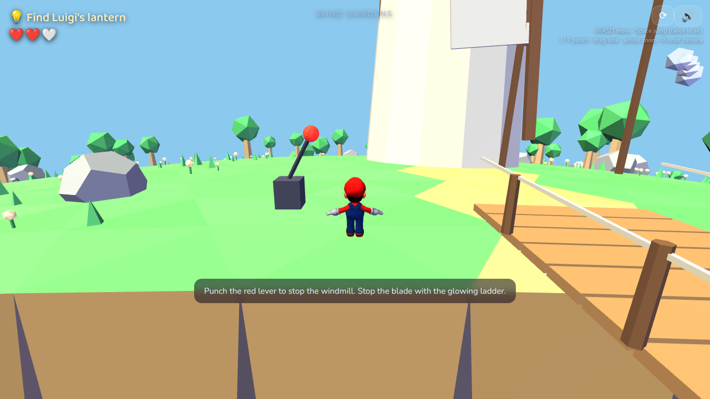
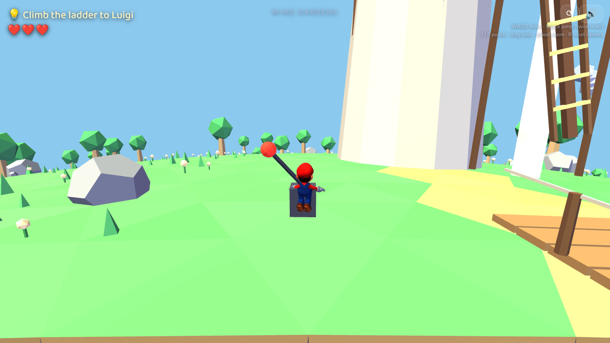
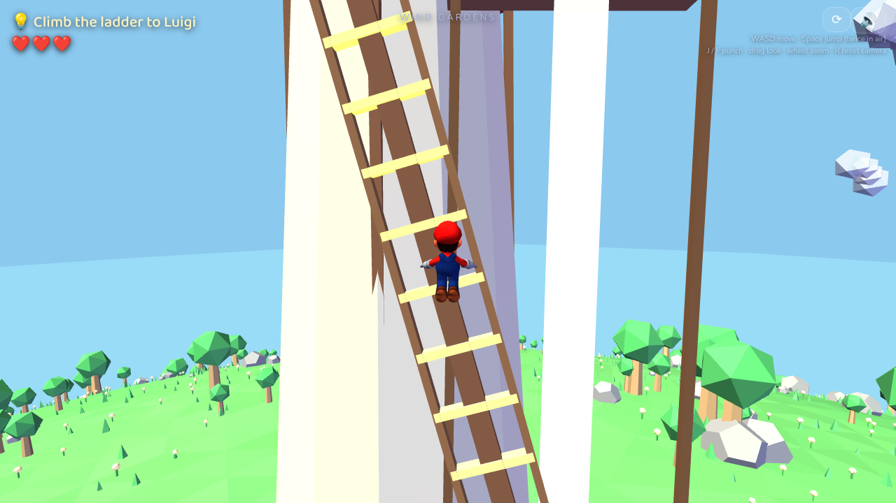

## 7. החילוץ / The rescue

הנחיתה במרפסת מפעילה את החילוץ פעם אחת: האח מסתובב, מנופף ויורד אל קרונית שעליה הסימן הצבוע, והשער לכוכב הבא נפתח.

Landing on the balcony triggers the rescue exactly once: the brother turns, waves and hops down to a cart marked הסימן הצבוע, and the gate to the next star opens.

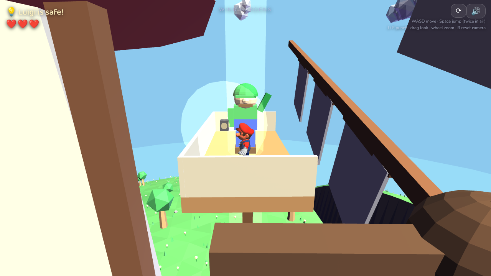
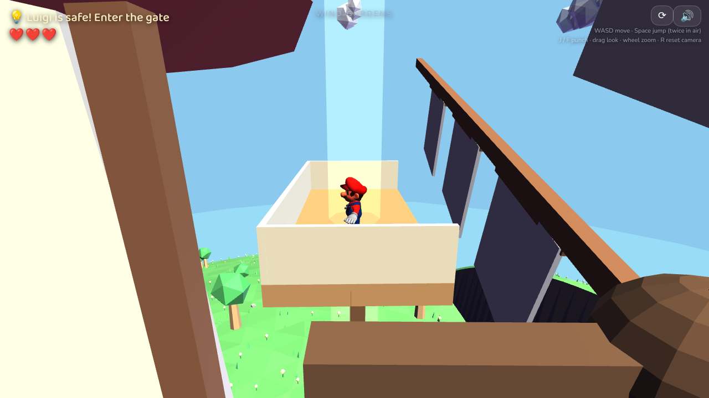

## 8. יום ולילה / Day and night

נוסף משטר יום ולילה: יממה שלמה נמשכת 5 דקות, כי הכוכב מסתובב סביב עצמו. המשחק מתחיל בבוקר, עובר לצהריים, לשקיעה מאחורי הטחנה וללילה, וחוזר לבוקר. בלילה נדלקים אורות סימון בשולי הגשר והרווח, הצל של הקופה מקבל טבעת זוהרת, והפנס של האח בולט יותר. בתמונה: הנחיתה, ראש הגשר ועמדת הבלם, בבוקר, בשקיעה ובלילה.

A day and night cycle: a full day lasts 5 minutes as the planet turns on its axis. The game starts in the morning, passes noon, sets behind the windmill and turns to night, then back to morning. At night, markers light the bridge and gap edges, the koopa's shadow gets a glowing ring and the brother's lantern stands out. Shown: the landing, the bridge top and the brake lever, at morning, dusk and night.

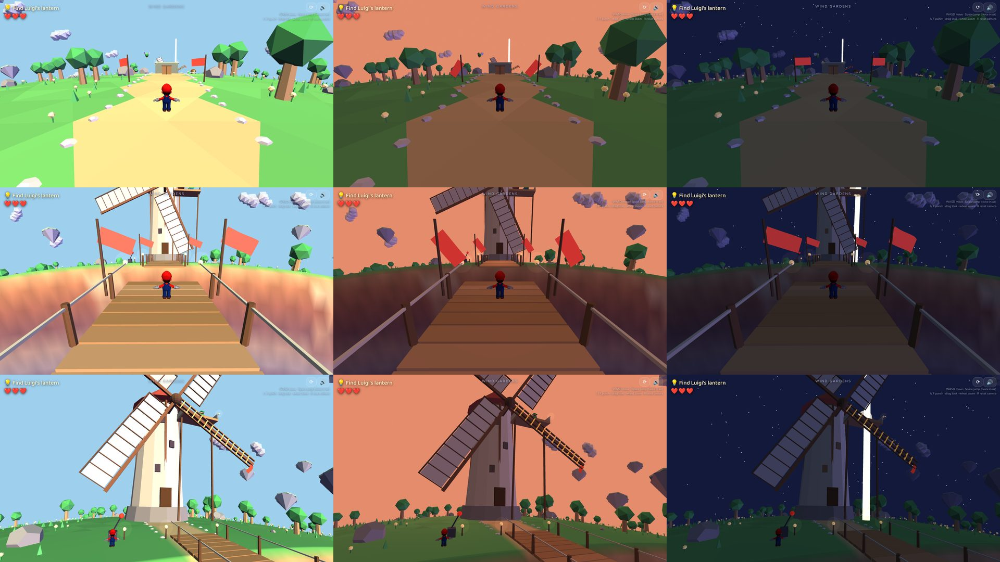

## 9. מעבר גרפי: שביל, שמיים וצללים / Graphics pass: path, sky and shadows

אחרי שהשלב עבד מקצה לקצה, עבר המראה סבב שלם. השביל הצהוב היה מצויר על משולשי הכוכב הגסים, ולכן נראה כמצולע חד. עכשיו הוא רצועה נפרדת שעוקבת אחרי הקרקע ונמסה לתוך הדשא. השמיים עוברים בהדרגה מהאופק למעלה, עם הילה סביב השמש. השמש מטילה צללים סביב הגיבור, ומתחתיו יש צל עגול שמראה איפה הוא ינחת. בשורה העליונה הכוכב המקורי והגרסה הראשונה של גני הרוח, ובתחתונה המצב עכשיו, בבוקר ובשקיעה.

Once the level worked end to end, the look got a full pass. The yellow path had been painted onto the planet's coarse triangles, so it read as a sharp polygon. Now it is its own ribbon that follows the ground and fades into the grass. The sky grades from the horizon upward, with a glow around the sun. The sun casts shadows around the hero, and a round shadow under him shows where he will land. Top row: the original planet and the first Wind Gardens; bottom row: now, at morning and dusk.

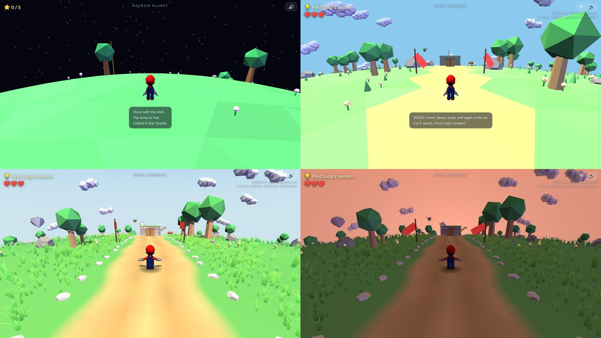

שלושת הפריימים שהוגדרו בכרטיס #5 (נחיתה, ראש הגשר ועמדת הבלם), בבוקר, בשקיעה ובלילה. משמאל לפני הסבב, מימין אחריו.

The three frames from issue #5 (landing, bridge top, brake lever) at morning, dusk and night. Left before the pass, right after.

| | |
|---|---|
| 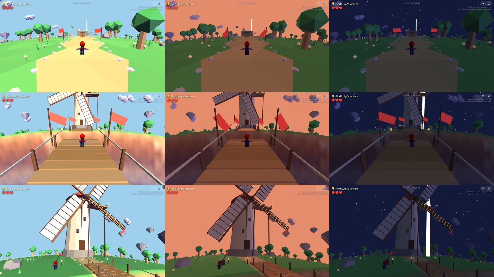 | 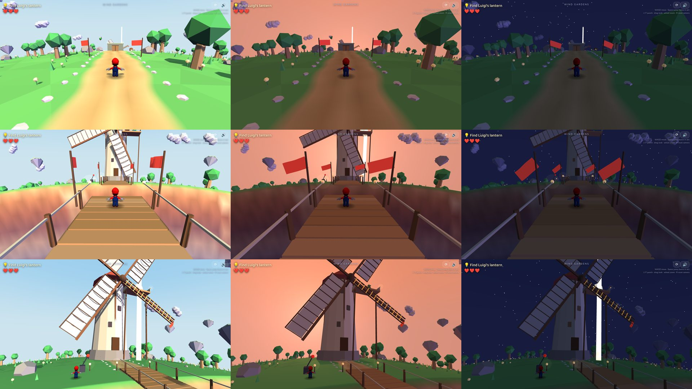 |

## 10. רשת שרואים, גם בלי צבע / A net you can see, even without colour

הרשת בתעלה הייתה קיימת בקוד, אבל משולשי הכוכב כיסו אותה. לתעלה נבנתה קרקע מפורטת משלה: רצפה חומה כהה ועליה רשת חבלים בהירה. הבדיקה הייתה בגווני אפור: דשא בהיר, תעלה כהה עם רשת בהירה ותהום שוקעת, כדי שגם ילד עם קושי בהבחנת צבעים יקרא את ההבדל.

The trench net existed in code, but the planet's triangles hid it. The trench got its own detailed ground: a dark brown floor with a light rope grid on top. The test was greyscale: light grass, a dark trench with a light net, and a falling abyss, so a child who struggles with colours still reads the difference.

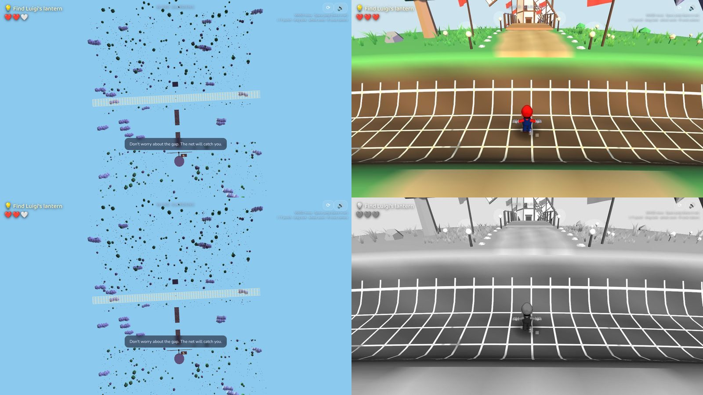

## 11. עשב, אבן וקרקע רכה / Grass, stone and a soft meadow

הקונוסים הירוקים הפכו לגושי עשב מעוקלים שזזים ברוח. התנועה מחושבת בכרטיס המסך ולא במעבד, ולכן אלפי גושים עולים כמעט כמו אחד. כל גוש מקבל גוון משלו בכתמים גדולים. הדשא עצמו מוצלל עכשיו כמשטח רך במקום משולשים. אבן הקפיצה הפכה מקופסה אפורה לחומת אבנים עם ראש דשא, באותן מידות בדיוק.

The green cones became curved grass clumps that sway in the wind. The motion is computed on the graphics card, not the processor, so thousands of clumps cost about as much as one. Each clump gets its own shade in large patches. The meadow itself now shades as a soft surface instead of triangles. The jump pedestal went from a grey box to a dry-stone block with a grass cap, at exactly the same size.

| | |
|---|---|
| 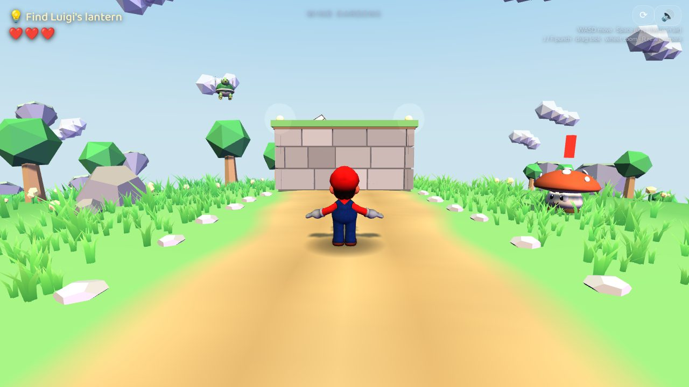 | 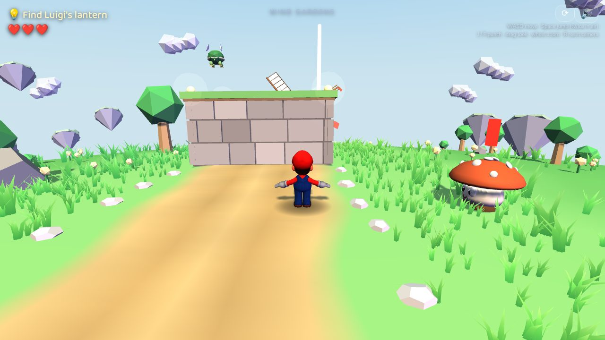 |

## 12. הטחנה והמרפסת / The windmill and the balcony

הטחנה היא היעד של כל השלב, ולכן היא צריכה להיראות טוב גם מרחוק. המגדל הפך למתומן עם קורות עץ, דלת עם מדרגות, חלונות ממוסגרים וגג עם חוד. הציר, שריחף קודם באוויר, נכנס עכשיו לבית עץ. המרפסת קיבלה רצפת קרשים ומעקה פתוח, כדי שהאח ייראה. בצד הכניסה מהסולם אין מעקה, כך שברור מאיפה עולים. מימין המצב החדש, משמאל הקודם: מרחוק, מהמרפסת ומהצד.

The windmill is the goal of the whole level, so it has to read well from far away. The tower became eight-sided with timber battens, a door with steps, framed windows and a cap with a finial. The shaft, which used to float in the air, now enters a timber housing. The balcony got a plank deck and an open rail so the brother stays in view. The entry side from the ladder has no rail, so it is clear where to climb on. Right: now; left: before. From afar, from the balcony and from the side.

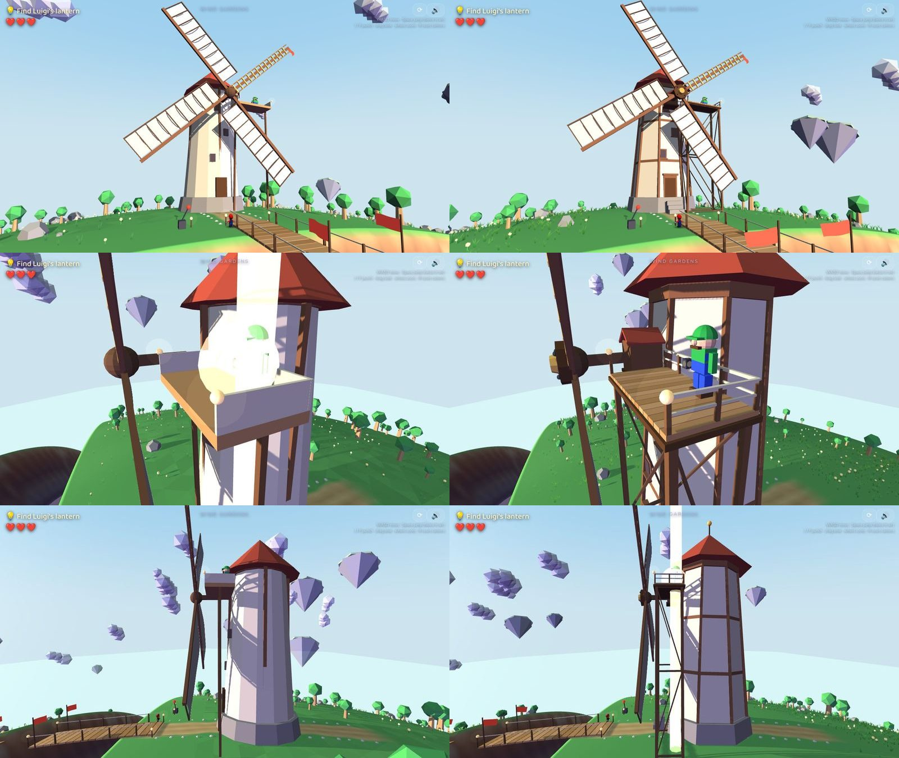

מעמדת הבלם רואים יחד את הידית, את כנף הסולם ואת האח במרפסת, כפי שהכרטיס דרש.

From the brake lever, the lever, the ladder blade and the brother on the balcony fit in one frame, as the issue asked.

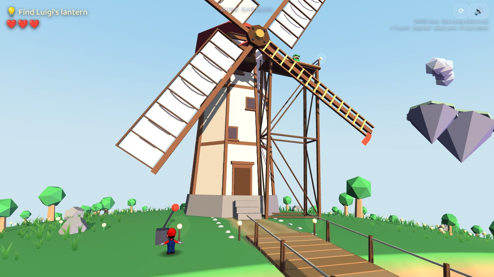

## 13. האויבים / The enemies

הלך הפטרייה והצב המכונף נבנו מחדש כיצורים מקוריים של המשחק: צורות מעוגלות, הצללה רכה, עיניים גדולות ופרטים קטנים כמו נקודות על הכובע ונוצות בכנפיים. המידות והחלקים שזזים נשארו כמו שהיו, ולכן ההתנהגות לא השתנתה. למטה: העשב והקרקע החדשים מהנחיתה.

The mushroom walker and the winged turtle were rebuilt as original creatures for this game: rounded forms, soft shading, big eyes and small details such as spots on the cap and feathers on the wings. Sizes and animated parts stayed the same, so their behaviour did not change. Bottom: the new grass and ground from the landing.

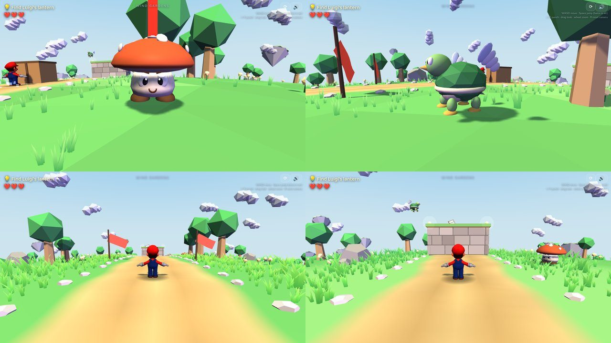

## 14. מהירות לארבעה שלבים / Speed for four levels

גרפיקה עשירה לא שווה הרבה אם הטלפון נתקע. נמצא שהמשחק בנה וצייר את כל ארבעת הכוכבים כל הזמן. עכשיו רק הכוכב הקרוב מצויר במלואו, וחלקים נייחים מאוחדים, כך שפקודות הציור ירדו מ־429 ל־310 בלי שינוי במראה. יש שלוש רמות איכות, ומסך מגע מתחיל ברמה הבינונית. כשהמשחק איטי, הרזולוציה יורדת מעצמה. לוח הכוונון (`?tune`) מציג את המספרים בזמן אמת, כדי למדוד על מכשיר אמיתי. בצילום רואים 2 פריימים בשנייה, כי הוא צולם ברינדור תוכנה. היעד במכשיר אמיתי הוא 30 לפחות. הכללים המלאים נמצאים ב־[`../../performance-rules.md`](../../performance-rules.md).

Rich graphics are worth little if the phone stutters. It turned out the game built and drew all four planets all the time. Now only the nearby planet is drawn in full, and static parts are merged, so draw calls dropped from 429 to 310 with no visible change. There are three quality tiers, and touch screens start at medium. When frames run slow, the resolution steps down by itself. The tuning panel (`?tune`) shows the numbers live, for measuring on a real device. The capture shows 2 frames per second because it was taken with software rendering; the target on a real device is at least 30. Full rules: [`../../performance-rules.md`](../../performance-rules.md).

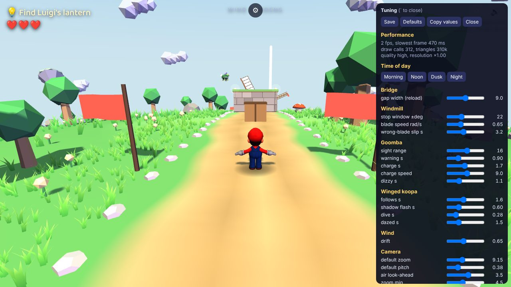

## מה היה חשוב בדרך / What mattered along the way

- **מקור אמת אחד.** רוח, בלם ושמות פעולות הקלט מוגדרים במקום אחד, כדי שכמה סוכנים יוכלו לעבוד במקביל בלי להתנגש.
  **One source of truth.** Wind, brake and input action names live in one place so several agents can work in parallel without collisions.
- **פיזיקה ותצוגה מאותה פונקציה.** התעלה והקניון משנים גם את הרשת הגרפית וגם את הקרקע לפי אותה נוסחה, כך שמה שרואים הוא מה שדורכים עליו.
  **Physics and visuals from one function.** The trench and canyon reshape both the mesh and the ground by the same formula, so what you see is what you stand on.
- **בדיקות דטרמיניסטיות.** סקריפט מקדם את הסימולציה בלי רינדור, ובודק קפיצות, חידה, אויבים ומעבר שלב.
  **Deterministic tests.** A script advances the simulation without rendering and checks jumps, the puzzle, enemies and the level transition.
- **לבדוק בגווני אפור.** מה שנבדל רק בצבע לא נבדל לכל ילד. רשת, דשא ותהום נבדקו בתמונה שחור־לבן.
  **Check in greyscale.** What differs only in colour does not differ for every child. The net, grass and abyss were checked in a black-and-white image.
- **מדידה לפני ואחרי.** כל אפקט נכנס עם מתג כיבוי (`?fx=`) ועם ספירת פקודות ציור ומשולשים לפני ואחרי.
  **Measure before and after.** Every effect came in with an off switch (`?fx=`) and a count of draw calls and triangles before and after.
- **מה עוד לא נעשה.** לא נבדק על טלפון אמיתי, ולא שיחק בו ילד. מודל האח הוא עדיין מצולעים פשוטים. יש שני ממצאים פתוחים: רוח גב שמאפשרת לפעמים לחצות את הרווח בקפיצה אחת, ומצלמה שיורדת לרגע מתחת לקרקע בתעלה.
  **Not done yet.** Not tested on a real phone, and no child has played it. The brother is still simple primitives. Two open findings: a tailwind that sometimes lets one jump clear the gap, and a camera that briefly dips under the ground in the trench.

פרטים טכניים מלאים / Full technical details: [`../../wind-gardens.md`](../../wind-gardens.md)

התמונות החדשות נוצרות מחדש עם / New images are regenerated with: `node tools/showcase.js wind-gardens` ([`shots.json`](shots.json))
